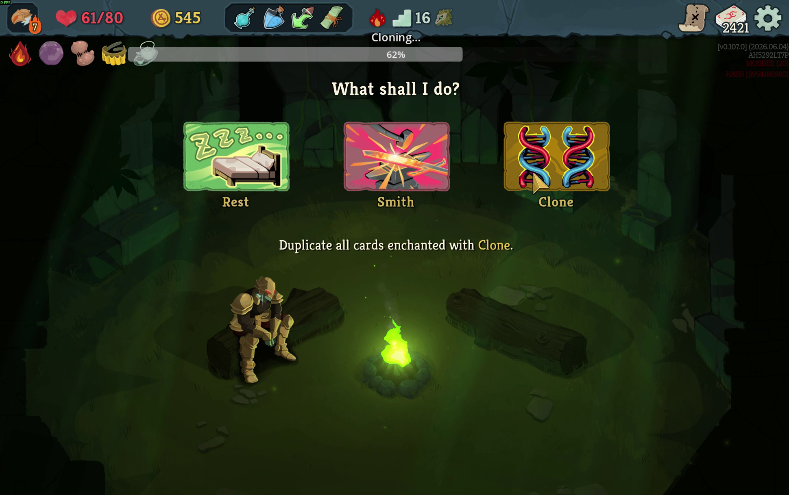

# StS2 Clone Optimizer

A **Slay the Spire 2** mod that keeps the **Pael's Growth** rest-site **Clone** event smooth on large decks.

[한국어 README](README.ko.md)

> The top progress bar (with percentage) shown while Pael's Growth clones a large deck — no freeze. [▶ Watch the demo](media/clone-demo.mp4)

## The problem

Pael's Growth's rest option clones **every Clone-enchanted card in your deck** — and that count **doubles every rest**. The base game performs this the slow way: it clones the cards one-by-one with a full fly-in animation each, then previews **all** of the new cards at once (one card node per clone). Once you have many Clone-enchanted cards, choosing the option **freezes the game** for seconds in a single frame.

## What this mod does

When a Clone is large enough to matter, it clones the **same cards** (identical gameplay result) but:

- **Batches** the add and skips the per-card fly animation.
- **Spreads the work across frames** so the game never hard-freezes — it stays responsive while cloning.
- Shows a **progress bar with a percentage** at the top of the screen so you can see it advancing.
- Plays the clone effect on a **small sample** of cards instead of rendering one node per clone.

Small clones are left **completely untouched** — the original animation is kept.

## Does it change gameplay?

No. The same cards are cloned into your deck; only the **rendering and timing** of the clone are optimized. Card effects, RNG, and outcomes are unchanged. `affects_gameplay` is `false`.

## Install

1. Download the latest release.
2. Extract the `Sts2CloneOptimizer` folder into your Slay the Spire 2 `mods/` directory.
3. Enable the mod in-game.

## Compatibility

- Single-player focused. As with most client-side mods, prefer solo play.
- No configuration required; it activates automatically only on large clone events.

## License

MIT © 2026 inggom
